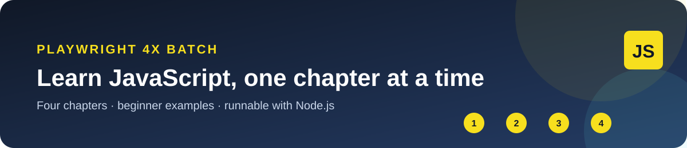
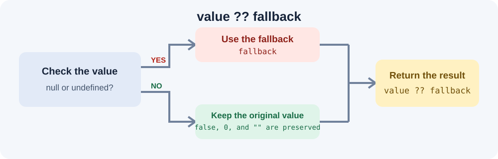

# Playwright 4X Batch

Beginner-friendly JavaScript examples organized by lesson chapter.



## Course contents

| Chapter | Topics | Examples |
| --- | --- | --- |
| [01 - JavaScript Basics](01_Chapter1_JS_Basics/) | Console output and introductory expressions | [Example 01](01_Chapter1_JS_Basics/01_Helloword.js) |
| [02 - Keywords and Identifiers](02_JS_Keywords_Identifiers/) | The JavaScript engine, variables, identifiers, comments, and naming rules | Examples 02-08 |
| [03 - Literals](03_chapter_JS__Literals/) | Null, undefined, numbers, and special values | Examples 09-15 |
| [04 - Operators](04_Chapter_JS_Operators/) | Assignment, arithmetic, comparison, and logical operators | Examples 16-22 |

## Run an example

Install [Node.js](https://nodejs.org/) and run a lesson from the project root. For example:

```powershell
node .\01_Chapter1_JS_Basics\01_Helloword.js
```

## Nullish coalescing reference

JavaScript's `??` operator uses a fallback only when the value is `null` or `undefined`; values such as `false`, `0`, and an empty string are preserved.


